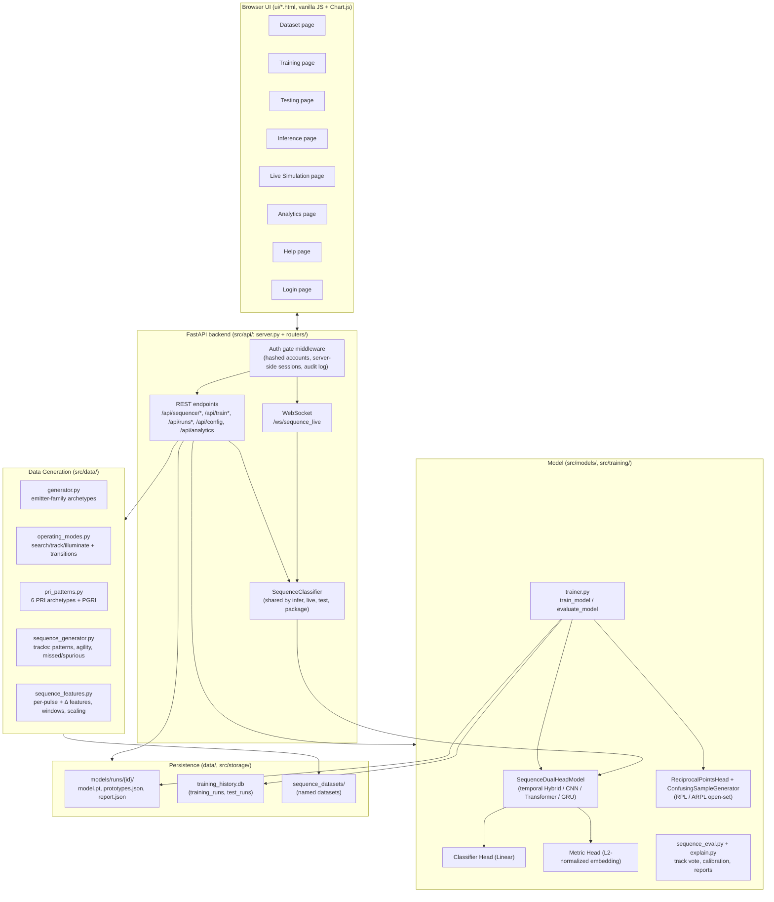
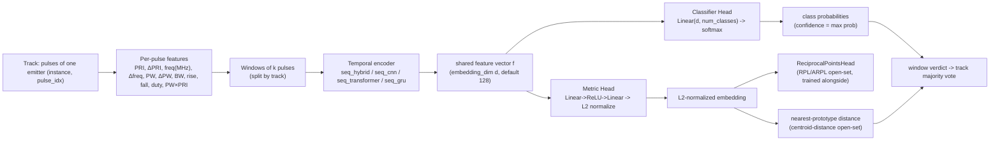
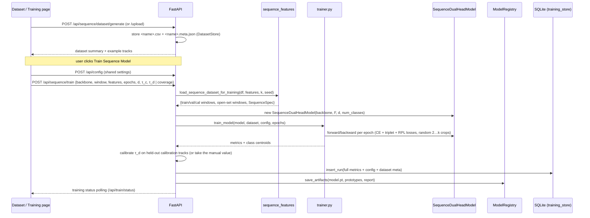

# DADS — End-to-End Solution Architecture

**DADS (PhD Research Project)** is a SOSA-aligned radar Electronic Support Measures (ESM)
research platform: a FastAPI backend simulating de-interleaved radar pulse trains, a PyTorch
dual-head sequence model for closed-set classification + open-set (unknown-emitter)
recognition, nearest-prototype matching, and a browser UI
covering the full workflow — generate/upload tracks, train, test, classify tracks, run a live
track simulation, and inspect results.

This document describes the system as it exists in the codebase, not an idealized target —
every component below is implemented and running.

> **History:** an earlier single-pulse pipeline (one PDW → one family: its dataset, backbones,
> feature registry, training, testing, inference and live feed) was removed once the sequence
> models superseded it. Code shared with the sequence pipeline (emitter archetypes, training loop,
> losses, open-set heads, evaluation report, registry, run history) stays.

---

## 1. High-Level Architecture



---

## 2. Repository Layout

```
DADS/
├── config/config.yaml            # embedding size / hyperparameter defaults
├── main.py                       # script entry point (uvicorn with reload)
├── VERSION, CHANGELOG.md          # release number (git tag v<VERSION>) and release notes; see docs/RELEASING.md
├── requirements.in               # direct dependencies (ranges) - edited by hand
├── requirements.txt, constraints.txt  # generated exact pins (scripts/pin_requirements.py)
├── requirements-dev.txt          # pytest, httpx, bandit, pip-audit
├── .github/                      # CI (tests, bandit, pip-audit), tag-triggered releases, Dependabot
├── tests/                        # pytest suite; every run uses its own DADS_DATA_DIR, never data/
├── src/
│   ├── api/
│   │   ├── server.py              # FastAPI app: auth gate middleware, security headers, error handler, mounts routers
│   │   ├── core.py                # shared state: paths, auth/dataset/model stores, config, job status, error helpers
│   │   ├── common.py              # helpers used by several routers (dataset lookup, run lineage, model cache)
│   │   └── routers/               # pages, runs, datasets, analytics, training, inference, incremental
│   ├── data/
│   │   ├── generator.py           # emitter-family archetypes (build_emitter_library), noise PW/PRI, frequency_to_band
│   │   ├── operating_modes.py     # search/track/illuminate mode definitions + transitions
│   │   ├── pri_patterns.py        # 6 PRI modulation archetypes (constant..dwell_switch) + PGRI
│   │   ├── sequence_generator.py  # track dataset: PRI patterns, freq agility, missed/spurious pulses
│   │   └── sequence_features.py   # per-pulse features (incl. Δ), windows, SequenceSpec, track split
│   ├── models/
│   │   ├── sequence_models.py     # temporal CNN / Transformer / Hybrid / GRU + SequenceDualHeadModel
│   │   ├── sequence_eval.py       # evaluation (stored prototypes, track vote, pulses curve), SequenceClassifier, explainability
│   │   ├── checkpoint.py          # sequence checkpoint bundle (weights + window + features + scaling)
│   │   ├── registry.py            # per-run artifacts, sequence model in use, pruning, download package
│   │   ├── package_signing.py     # package hash manifest + Ed25519 signature; shipped as verify_package.py
│   │   ├── explain.py             # evaluation report (confusion, F1, ROC), branch ablation, weights export
│   │   ├── open_set.py            # ReciprocalPointsHead, ConfusingSampleGenerator (RPL/ARPL)
│   │   └── deploy/sequence_inference.py  # standalone inference script shipped in the model package
│   ├── training/trainer.py        # train_model (CE + triplet + RPL/ARPL), evaluate_model, build_distance_fn
│   ├── analytics/dataset_analysis.py  # Dataset page + Analytics computations (shared)
│   └── storage/training_store.py  # SQLite persistence for training_runs / test_runs
├── ui/                            # index (Training), validation (Testing), inference,
│                                   #   dataset, analytics, live, help, login — all static HTML+JS
└── data/                          # runtime-generated, gitignored: models,
                                    #   sequence_datasets, training_history.db
```

---

## 3. Data Generation Layer

One dataset pipeline, the **Sequence Dataset**:

| | Sequence Dataset |
|---|---|
| Purpose | Trains/tests the sequence models |
| Builder | `sequence_generator.build_sequence_dataset_rows()` (or a user-uploaded CSV) |
| Shape | One row per pulse, in this column order: `Frequency` (MHz), `PW` (µs), `PRI` (µs), `Modlntype`, `Modlnval`, `snr` (dB), `rise` (ns), `fall` (ns), `timeBW` (Hz), user-defined extra features, `instance` (track: class + capture date + number), `class` (emitter name), then `pulse_idx` and `true_class_id` (−1 = unknown; bookkeeping, not model inputs) and the simulator's ground truth. Files with the earlier names (`track_id`, `true_label`, `pri_us`, `carrier_freq_*`, …) are converted by `upgrade_columns` |
| Consumers | Training, Testing, Analytics, Inference/Live (via the model's population) |

### 3.1 Emitter simulation (`generator.py`, `sequence_generator.py`)
- `build_emitter_library(num_classes, seed, freq_range, pw_range, pri_range, rise_range, …, duty_range)` draws
  one base centroid per radar family, plus a `pri_pattern` (one of 6 modulation types from
  `pri_patterns.py`, or PGRI when enabled) — so families differ not just in mean values but in PRI *shape*.
  Pulse width follows from a per-family duty cycle (`family_pulse_width`: PW = duty × PRI, duty
  log-uniform in `duty_range`, default 0.1–10%, PW range as an outer limit), so a pulse never
  exceeds its interval. Bandwidth and fall time come from their own seeded stream so older seeds regenerate unchanged.
- `sequence_generator.generate_track(family, n_pulses, rng, missed, spurious, ranges)` turns a family into
  an ordered track: the PRI follows the family's pattern in time (stagger cycle, ramp, sine, dwell blocks,
  pulse groups), the carrier follows its frequency agility (fixed / hopping / stepped / burst), and the
  operating mode persists for a dwell of 15–60 pulses before a biased transition (`operating_modes.py`).
  **Missed** pulses (the next PRI becomes the sum of two intervals) and **spurious** pulses (another emitter's
  pulse inserted into the track) model imperfect de-interleaving.
- `generate_noise_track` draws unstructured noise tracks (`UNKNOWN_NOISE_OOD`): deliberately overlapping the
  low end of known ranges rather than occupying a trivially-separable band. Held-out families are chosen from
  the dataset seed (`trainer._select_holdout_ids`), so the exact known/unknown split can be reconstructed later.
- `frequency_to_band(freq_mhz)` maps a carrier frequency to its radar band letter (L/S/C/X/Ku/K/Ka) — used for prototype metadata and Analytics.
- Ground-truth columns (`pri_pattern`, `freq_agility`, `operating_mode`, `pri_mode_base_us`,
  `pri_deviation_pct`, `missed_before`, `spurious_before`, `is_spurious`) are written for inspection and are
  never model inputs.

### 3.2 Per-pulse sequence features (`src/data/sequence_features.py`)
`SEQ_FEATURES` defines every built-in feature in terms of the raw track columns it needs:

| Feature | Raw column(s) | Notes |
|---|---|---|
| `pri`, `d_pri` | `PRI` | µs; Δ = change from the previous pulse of the same track |
| `freq`, `d_freq` | `Frequency` | MHz (fed to the model as Hz; old `carrier_freq_hz` files are converted on load) |
| `pw`, `d_pw` | `PW` | µs |
| `snr`, `modval` | `snr`, `Modlnval` | dB / chirp rate or code length |
| `modtype` | `Modlntype` | text, fed as its position in `MODULATION_TYPES` |
| `bw`, `rise`, `fall` | `timeBW`, `rise`, `fall` | bandwidth in Hz (fed to the model as MHz; old `bandwidth_mhz` files are converted on load); rise/fall of 0 = not measured |
| `duty_cycle`, `pw_x_pri` | `PW`, `PRI` | derived |
| `col:<c>`, `dcol:<c>`, `cat:<c>` | any extra column `<c>` | numeric value / its Δ / text column fed as `crc32(text)` fraction (stable, no category list stored) |

Any subset can be selected per training run (Training page, Sequence Model card). Per track, the first
pulse's blank PRI takes the 2nd pulse's (Δ = 0); other gaps are filled from the same track (leading gap →
first measured value, otherwise the track median). Δ features get a signed-log step
(`sign·ln(1+|Δ|/c)`, c = median |Δ| over training pulses), then every feature is z-scored with the training
tracks' mean/std. The ordered feature list, window length and scaling live in a `SequenceSpec`, saved inside the
model checkpoint, so inference and evaluation always use what the model was trained with.

**Dataset features**: any extra numeric column in an uploaded track file becomes selectable as its value
(`col:<name>`) and/or its per-track Δ (`dcol:<name>`). The track simulator can't produce such a column, so a
model using one can't run on simulated tracks (Live Simulation, example tracks, Testing's fresh tracks) —
it is tested on track files. A model needing a column the current source can't supply fails with a clear
message, never silently.

Time of arrival is not a model input: only the per-pulse PRI a de-interleaver reports. RSSI/amplitude is
not present anywhere in the system (it depends on range/antenna pointing/receiver AGC rather than being an
emitter fingerprint).

---

## 4. Model Architecture

`SequenceDualHeadModel` (`src/models/sequence_models.py`) takes `[batch, pulses, features]` — a window of
consecutive pulses of one de-interleaved track — through a temporal encoder into two heads:



- **Encoder** — selectable per run: `seq_cnn` (dilated Conv1d along pulses with mean+max pooling),
  `seq_transformer` (per-pulse tokens + sinusoidal positional encoding, mean pooling), `seq_gru`
  (bidirectional GRU) or `seq_hybrid` (default; CNN and Transformer branches fused by a learned layer). Every
  encoder pools over time, so one model accepts any window length ≥ 1 — which is what allows a decision from the
  2nd pulse of a track and an ONNX export with dynamic pulses.

  | Key | Backbone | What it does | Strength | Weakness |
  |---|---|---|---|---|
  | `seq_cnn` | Temporal 1D-CNN | 3 conv layers along the pulse axis (features = channels), dilations 1/2/4 → receptive field of 15 pulses; mean+max pooling, then a linear layer to the embedding | Local patterns: stagger cycles, dwell switches, ramps; small and fast | Limited receptive field; misses far-apart pulse relations |
  | `seq_transformer` | Temporal Transformer | Each pulse is a token; sinusoidal positional encoding keeps pulse order; 2 encoder layers, 4 heads, d_model 64; mean pooling | Attention relates every pulse to every other (long-range structure) | Heavier, needs more data; eval path uses an ONNX-safe attention that accepts any window length |
  | `seq_gru` | Bidirectional GRU | 2-layer GRU reading pulses both directions; mean of outputs + final states | Order-aware baseline, no positional encoding needed | Sequential, slower; weaker on long windows |
  | `seq_hybrid` | CNN + Transformer, fused | CNN and Transformer run in parallel (64-d each); a learned linear layer fuses the 128-d concatenation | Local patterns and global relations together | Largest and slowest to train |

  All four feed the same classifier and metric heads; only the encoder differs. (`SequenceDualHeadModel`'s
  constructor default is `seq_cnn`; the backbone is chosen per run in the Sequence Model card.)
- **Classifier head** — a single `Linear(embed_dim, num_classes)`; softmax confidence = `max(softmax(logits))`.
- **Metric head** — projects to an L2-normalized embedding space used for open-set distance scoring and for RPL.
- **Two independent, simultaneously-trained open-set methods**, both reported every run so they're directly comparable:
  1. **Embedding-centroid threshold** — distance to the nearest prototype vs. the model's τ_d.
  2. **RPL / ARPL** (`src/models/open_set.py`) — Reciprocal Points Learning (Chen et al., ECCV 2020): each class has a
     learned "reciprocal point" representing what it *isn't*; distance to it becomes the classification logit, and the
     top-1/top-2 confidence gap is the open-set anomaly score. Optionally extended adversarially (ARPL, TPAMI 2021)
     via `ConfusingSampleGenerator`, a small MLP trained in a min-max game against the reciprocal points directly in
     embedding space (no image-style decoder, since the data is tabular).
- Checkpoints (`checkpoint.py`) carry `kind: "sequence"`, the backbone, embedding size, class count and the
  `SequenceSpec`.
- `SequenceClassifier` (`sequence_eval.py`) is the one track-classification path used by `/api/sequence/infer`,
  `/ws/sequence_live` (last ≤ k pulses per track after every pulse) and — mirrored in
  `src/models/deploy/sequence_inference.py` — the model package (ONNX with dynamic batch × pulses, TorchScript).
  Track windows are `[1..k], [k+1..2k], …` plus a final window ending at the last pulse; track class and verdict
  are the most frequent window class / verdict.

---

## 5. Prototype Search (no vector database)

Each run stores its prototypes in `runs/<id>/prototypes.json`: per known class up to 3 K-means centres of the
training-window embeddings (unit length; validation and open-set windows are only scored against them, so the
reported AUROC is not inflated by windows that placed the prototypes), with metadata (label, frequency band). The nearest prototype to a
window embedding is found by an exact comparison with every centre, using `trainer.build_distance_fn(metric)`
(cosine → `1 − cos`, euclidean → `‖a − b‖`; the label `dot` on runs from before v1.2.0 also means `1 − cos`). With a few dozen prototypes that takes microseconds, and the
model package (`sequence_inference.py`) performs the identical arithmetic, so no database, index or server is
involved anywhere.

A vector database or ANN index (HNSW, quantization) would only pay off for emitter libraries of many thousands
to millions of vectors — e.g. library-scale identification where new emitters are enrolled without retraining.
That is a possible extension, not part of DADS: an earlier embedded-Qdrant integration was removed because
no sequence result ever passed through it.

---

## 6. Training Pipeline



### 6.1 Dataset is generated (or uploaded) *before* training
The Dataset page produces a **named dataset**, `data/sequence_datasets/<name>.csv` +
`<name>.meta.json` (managed by `src/storage/dataset_store.py`; `name`, `total_tracks`, `total_pulses`, `dataset_seed`, `num_classes`, `num_holdout_classes`, `tracks_per_class`,
`pulses_per_track`, `missed_pct`, `spurious_pct`, `noise_track_pct`, `known_class_ids`, `holdout_class_ids`,
`ranges`, `include_pgri`, `balanced_patterns`, and for uploads `class_labels`). Training reads only the chosen dataset — it never generates
data itself — so retraining without regenerating reuses the exact same population. Every dataset (generated, uploaded for training,
uploaded for testing) appears in one list; one is the *default* (`_active.json`) that the Training page offers first; any can be
deleted. Each training run stores its `dataset_name` (and each test run the dataset it was tested on), so every page can say which
dataset is in force; Analytics also offers the dataset behind each kept model (rebuilt from the run's seed for runs that predate
names). `balanced_patterns` hands the six PRI types out round-robin to the families (known first), so a dataset with ≥ 6 families
contains every type instead of leaving it to a random draw.

### 6.2 Two ways to produce that file
1. **Generate** (`POST /api/sequence/dataset/generate`) — classes, holdout count, tracks per class, pulses per
   track, missed / spurious %, noise tracks %, PGRI, and the 14 physical range fields. Capped at 3,000,000 pulses.
   Optional **extra features** (`extra_features`: name + numeric min/max/noise % or categorical values) add user
   columns that every later stage — training, test, Inference example, Live Simulation — reproduces from the
   dataset's meta; `capture_date` sets the date part of the `instance` names.
2. **Upload your own tracks** (`POST /api/sequence/dataset/upload`) — one row per pulse with `instance`,
   `class` (or `true_class_id`, −1 unknown), at least one measurement column, optional `pulse_idx`. Class ids are
   remapped to contiguous `0..N-1`, blank / non-numeric class ids count as unknown, the file's own class names are
   kept (`class_labels`), and a matching meta file is synthesized so it slots into the same training path.
3. **Grow a small dataset** (`POST /api/sequence/dataset/expand`, `src/data/dataset_expander.py`) — every class is
   topped up to N tracks: a new track starts from one of the class's own tracks at a random point of its pulse
   pattern, scaled (SNR shifted) by the between-track spread of that class (±2σ; none for a one-track class).
   No noise is added. The source dataset is unchanged.

### 6.3 Split, windows and thresholds
Split by **track** (never by window — overlapping windows of one track are near-copies) and **per family**, as
**cross-validation** (`cv_split`): `test_pct` % of every family's tracks form the **test split** (kept for the Testing
page; also trained on only with *include test*); the rest is cut into `cv_folds` buckets and fold *f* validates on
bucket *f* and trains on the others (20 % test + 4 folds = 20:20:20:20:20). 10 % of a fold's training pool is held
back for calibration. One model is trained per fold (seed `train_seed + fold`); the highest validation accuracy is kept. The run's
`closed_set_accuracy` / `open_set_auroc` / `open_set_auroc_rpl` are the **means over the folds** (the kept fold's
own validation score is a maximum and therefore optimistic; it is kept in the report as `kept_fold_validation`).
The run stores every fold, the mean ± std (`cv_accuracy_mean/std`) and the test-split tracks and result in the
report (`cross_validation`). Held-out families and noise tracks form the open-set pool of every fold, except the
test split's unknown tracks, which stay out so the test result's AUROC is independent. Runs trained before this
change report the kept fold's validation score and val-built prototypes; retrain to compare like with like.
**Input mode** (Training page → Sequence Model card → *Input*, API `window_mode`): `windows` (above) or `track` -
no windowing: ONE input per track = its first N pulses (N = the cap, default 128; 0 = no cap, up to 512 pulses).
Tracks of different lengths share a batch padded at the end, with a mask (one extra input channel; `pad_stack`) that
every backbone honours exactly - a padded track gives the same output as the same track alone (`tests/test_masking.py`).
Training still crops random prefixes of 2…N pulses, so early decisions keep working; a track is one decision (no vote),
made on its first ≤ N pulses. The mode is stored in the checkpoint's `SequenceSpec` and the run's `window_mode`.
Which input mode and window length suit a dataset is measured with `scripts/window_grid.py` (all backbones x
`k<N>`/`track<N>` settings on one seed and the same test tracks; results.csv/json/md under `data/benchmark_results/`).
Training windows use stride k/2, evaluation windows stride k; half the training batches crop every window to
a random 2…k pulses. Prototypes (≤ 3 K-means centres per class) come from validation windows. τ_d is calibrated
on the calibration tracks only (known data), as a quantile per window length below k; τ_c comes from the
form or the request.

### 6.4 What gets persisted after a run
`runs/<id>/model.pt` (checkpoint bundle), `prototypes.json`, `report.json` (architecture formulas, feature
importance, evaluation, track evaluation, thresholds, class labels, branch ablation) and a full row in
`training_history.db`'s `training_runs` table — backbone, metric, hyperparameters,
closed-set accuracy, both open-set AUROCs, loss curve, dataset seed/ranges, features, window, epochs, duration.
Unsaved runs beyond the newest 20 are pruned (saved and in-use runs never are). All of this survives a restart.

### 6.5 Incremental training (`src/training/incremental.py`)
`POST /api/sequence/incremental {parent_run_id, dataset, methods, finetune_epochs, full_epochs, replay_tracks_per_class,
lr_scale, eval_fraction}` runs in the background like training. `_incremental_inputs` builds everything once, so the
methods are compared on identical data: the base model's labels by name plus the new labels (`map_labels`), the
base model's split rebuilt from its seed (`split_track_ids`), its validation tracks as the old-family evaluation set,
a seeded share of each new family's tracks as the new-family evaluation set, the new dataset's unknown tracks, the
replay buffer (B) and the old training tracks (D). `run_method` trains A (imprinting), B (replay fine-tune), C
(distillation) or D (full retrain); `score` evaluates with `evaluate_tracks`. Each child model is saved as a normal
run (`parent_run_id`, `incremental_method`; report keys `incremental`, `population`) and each comparison as JSON in
`data/incremental_experiments/`. `population.revealed_class_ids` records held-out families a model has been taught,
so example tracks, fresh test tracks and Live Simulation treat them as known (`_population_split`;
`build_sequence_dataset_rows(..., reveal_class_ids)` keeps the library of the original holdout).

---

## 7. Testing / Evaluation Pipeline

`POST /api/sequence/test` evaluates a kept model against one of three track sources:
1. **Fresh tracks** (`source: "auto"`) — new tracks of the model's own families, regenerated from the model's
   seed, ranges, PGRI setting and noise level (new track seed); tracks per class, pulses per track and
   missed / spurious % are adjustable (blank = as trained).
2. **The current sequence dataset** (`source: "dataset"`) — includes the training tracks, so it is optimistic.
3. **An uploaded track file** (`source: "uploaded"`, via `POST /api/sequence/test/upload`) — labelled tracks in
   the dataset format; its class ids are matched to the model's classes by label name (`relabel_by_name`).

Scoring uses the model's **stored prototypes and thresholds** (τ_c / τ_d overridable per test, window length
overridable). Metrics: window accuracy, open-set AUROC, track accuracy (vote), unknown tracks flagged, the verdict
split and an accuracy-vs-pulses-observed curve. Every test run records its source, counts, seed, features, model
run id/name and track accuracy in `test_runs`, so a Testing-page result can be traced to its population.

---

## 8. Inference Pipeline (`SequenceClassifier`)

One class, shared by `POST /api/sequence/infer`, `/ws/sequence_live` and Testing, so all compute identically:

1. Per-track features and scaling from the model's `SequenceSpec` → k × F windows (shorter tracks give one shorter window).
2. One forward pass per batch of windows → `probs`, `embeddings`.
3. `class = argmax(probs)`, `confidence = max(probs)`; nearest stored prototype + distance.
4. **Fusion verdict** per window — combines classifier confidence and prototype distance:

| Confidence ≥ τ_c | Distance ≤ τ_d | Verdict | Color | ECM action |
|---|---|---|---|---|
| Yes | Yes | `VERIFIED_KNOWN_TARGET` | Green | Monitor only |
| Yes | No | `UNKNOWN_THREAT_ANOMALY` | Orange | Automated jammer engaged |
| No | — | `OOD_NOISE_REJECTED` | Red | ELINT logging |

5. Track class / verdict = most frequent over its windows. The progression (decision after each new pulse from
   the 2nd, from the pulses seen so far only) uses τ_d for that window length.

τ_c and τ_d are properties of the model (stored with the run), not global settings.

---

## 9. Live Simulation

`/ws/sequence_live` drives `ui/live.html`. Several simulated emitters (up to 12) transmit at once; every pulse
arrives already assigned to its track, as from a de-interleaver. After each pulse from the 2nd, the track's last
≤ k pulses are classified. Tracks of 40–200 pulses end and new emitters spawn; a share of new tracks is unknown
(70% held-out families, 30% noise tracks, when the model has held-out families). Missed / spurious rates, pulses
per second (≤ 100) and duration (≤ 15 minutes, hard server cap) are adjustable. Ground truth is sent for scoring
only — never to the model. The socket independently checks the session (`_session_user`) and the `Origin` before accepting.

---

## 10. Persistence Summary

| Artifact | Location | Survives restart? |
|---|---|---|
| Per-run model, prototypes, report | `data/models/runs/<id>/` | Yes (unsaved: newest 20) |
| Sequence model in use | `data/models/active_sequence_run.json` | Yes |
| Staging checkpoint | `data/models/sequence_training.pt` | Overwritten each run |
| Training run history | `data/training_history.db` (`training_runs` table) | Yes |
| Test run history | `data/training_history.db` (`test_runs` table) | Yes |
| Datasets (generated / uploaded) | `data/sequence_datasets/<name>.csv` + `<name>.meta.json`, default in `_active.json` | Yes |
| Retired dataset names | `data/sequence_datasets/_retired.json` | Yes |

**Lineage** (`src/storage/dataset_store.py`):
- A dataset's meta records the SHA-256 of its CSV (`sha256`); uploads also record `original_sha256`.
- `training_runs.dataset_sha256` and `test_runs.dataset_sha256` record the hash of the data used, and
  `training_runs.app_version` records the release that trained the model.
- A name is never reused, whether it belongs to a stored, a deleted (retired) or a run-referenced dataset.
  Names are compared case-insensitively, as Windows file names are.
- `_check_run_dataset` refuses a model's dataset whose hash no longer matches. It is used by the test-split
  test, example tracks, Analytics' model source and incremental training.
- The model package's `model_card.json` carries `dads_version`, `dataset_name`, `dataset_sha256` and `train_seed`.

**Concurrency.** Route handlers that read files, parse CSVs or run a model are plain `def`, so FastAPI runs them in
worker threads. Background jobs and the Live Simulation loop hand their heavy steps to `asyncio.to_thread`.
The one-model cache (`_seq_cache`) is guarded by a lock. List endpoints cap their sizes: `limit` 1–500, scatter
rows ≤ 5000, boxplot classes ≤ 50.

At startup, the server reloads the settings of the sequence model in use (or the latest run) from SQLite —
embedding size, `num_classes`, distance metric, thresholds, RPL settings — so the
Training form agrees with what is persisted, rather than silently falling back to
`config.yaml` defaults.

---

## 11. Authentication

Code: `src/storage/auth_store.py`, wired in `src/api/core.py` and the gate in `src/api/server.py`; accounts are managed with `scripts/manage_users.py`.

- **Accounts**: `data/auth.db` (SQLite), passwords as salted PBKDF2-SHA256 (600 000 iterations). No credential
  is in the source. On first start with no accounts, `admin` is created from `DADS_ADMIN_PASSWORD`, or with a
  random password written to `data/INITIAL_ADMIN_PASSWORD.txt`.
- **Sessions**: `POST /api/login` checks the password in a worker thread (PBKDF2 is slow on purpose; an unknown
  user name costs the same time), ends any session the browser already had, and issues a new random 256-bit token
  in the `dads_session` cookie (`HttpOnly`, `SameSite=Strict`, `Secure` over HTTPS). Only the token's SHA-256 is
  stored. Sessions end after 2 h idle, 12 h in total, on Logout, or when the user's password changes or the
  account is disabled.
- **Throttling**: `LoginLimiter` blocks an address after 5 failures for one user name, or 20 in total, within
  15 minutes (HTTP 429 with `Retry-After`). It never locks the account itself.
- **Gate**: a global `@app.middleware("http")` (`auth_gate`) blocks every route except `/login`, `/api/login` and
  `/static/shared.css` unless the session is valid: pages redirect to `/login`, API calls get 401. A POST/DELETE
  whose `Origin` is another site gets 403. The gate rejects bodies above 110 MB and adds security headers to every
  response (CSP, `X-Frame-Options: DENY`, `nosniff`, `Referrer-Policy`, `Permissions-Policy`, HSTS over HTTPS;
  `Cache-Control: no-store` for `/api/*`).
- **Audit trail**: `data/audit.log`, one JSON line per sign-in (and failure / block), sign-out, account change,
  state-changing API request, download and Live Simulation session, with user, address and status. Each line
  carries the SHA-256 of the previous one; `manage_users.py verify-audit` checks the chain.
- The `/ws/sequence_live` WebSocket handler checks the session itself and that the `Origin` matches the host; at most 4 live
  sessions run at once.
- Untrusted input: uploads are limited to 100 MB / 5 M pulses, pasted inference text to 5 M characters; column names and
  text labels of uploaded files have markup characters removed (`sanitize_frame`), dataset downloads neutralise spreadsheet
  formulas, and model checkpoints load with `torch.load(weights_only=True)`. Chart.js is served from `ui/vendor/`, not a CDN.
- Output: every page escapes server text with the one helper in `ui/escape.js` before it goes into `innerHTML`.
- Errors: `_public_error` cuts file paths out of messages shown in the browser. `_explain_error` and the catch-all
  exception handler show unexpected errors only as a reference; `_error_reference` logs the traceback under it in
  `data/logs/dads.log` (rotating; `DADS_LOG_LEVEL`).
- Model packages (`src/models/package_signing.py`): `registry.build_sequence_package` adds `MANIFEST.json`,
  which holds the SHA-256 and size of every file plus provenance (run, release, dataset name and hash, seed). When
  `cryptography` is installed it also adds `MANIFEST.json.sig`, an Ed25519 signature by the server key in
  `data/signing/` (private key mode 600, created on first use). The module is shipped in the package as
  `verify_package.py`. The package's `sequence_inference.py` runs it before loading any model file, allowing extra
  files (user output, TensorRT engines) but no changed or missing ones. `--trusted-key` also requires a valid
  signature by that key. Each export is audited with the package's SHA-256.
- Data handling rule: `docs/DATA_HANDLING.md`. Threat model and security policy: `SECURITY.md`.

---

## 12. Configuration (`config/config.yaml`)

```yaml
model:
  embedding_dim: 128           # default; the Sequence Model card sets it per run (8–256)
  num_classes: 20              # overridden by the dataset

hyperparameters:
  learning_rate: 0.001
  triplet_margin: 0.5
  classifier_confidence_threshold: 0.88
  ood_distance_threshold: 0.42   # starting value; auto-calibrated per sequence model by default
  distance_metric: cosine      # cosine | euclidean
```

These are only the *initial* defaults — `num_classes` is overridden by whatever dataset was generated/uploaded,
the backbone, window and features are chosen per run in the Sequence Model card, and the shared fields are
live-editable via Apply Configuration on the Training page (persisted into each `training_runs` row, then
restored at next server startup from the model in use / latest run). RPL weight and the ARPL switch also live on
the Training page (`rpl_loss_weight`, `rpl_adversarial`).

---

## 13. API Reference

| Method | Path | Purpose |
|---|---|---|
| GET | `/login` | Login page |
| POST | `/api/login` | Check the password (throttled), start a new session, set the session cookie |
| POST | `/api/logout` | End the session on the server and clear the cookie |
| GET | `/api/me` | The signed-in user |
| GET | `/`, `/validation`, `/inference`, `/dataset`, `/analytics`, `/live`, `/help` | UI pages |
| GET/POST | `/api/config` | Read/update the shared training settings (hyperparameters, metric, RPL, embedding size) |
| POST | `/api/sequence/dataset/generate` / `upload` | Sequence Dataset (tracks of one emitter each); upload remaps class ids |
| GET | `/api/sequence/dataset` / `download` | Summary (patterns, agility, example tracks) / CSV |
| GET | `/api/sequence/options`, `/api/sequence/models` | Sequence features + backbones; kept runs |
| POST | `/api/sequence/train` | Start a background sequence training run |
| GET | `/api/train/status`, `/api/train/history` | Poll progress / past runs (`is_active` = model in use) |
| POST | `/api/sequence/test`, `/api/sequence/test/upload` | Evaluate a run on fresh tracks / the dataset / an uploaded file; recorded in `test_runs` |
| GET | `/api/sequence/test/uploads`, `/api/test/history` | Uploaded test files / past test runs |
| POST | `/api/sequence/models/activate` | Make a run the model in use (Inference, Live Simulation) |
| POST | `/api/sequence/infer`, `/api/sequence/example_track` | Track classification (windows, vote, progression) / simulated example track |
| WS | `/ws/sequence_live` | Live Simulation: concurrent simulated emitters, per-track decisions after every pulse |
| GET | `/api/runs/{id}` | Run record + evaluation/explainability report |
| DELETE | `/api/runs/{id}` | Delete the run's history row, `runs/<id>/` artifacts and its `test_runs` rows (matched on run_id); refused during training; clears the model in use if it was that run |
| POST / DELETE | `/api/runs/{id}/save` | Save under a unique name / unsave |
| GET | `/api/runs/{id}/download`, `/api/runs/{id}/weights` | Deployable .zip (signed hash manifest) / all weights as JSON |
| GET | `/api/package-key` | Public key that signs packages |
| GET | `/api/health` | Up/down for monitoring (no sign-in) |
| GET | `/api/dataset/inspect` | Dataset page health check: composition, per-feature mini-histograms + configured ranges, data quality |
| GET | `/api/analytics`, `/api/analytics/sources` | Deep analytics (per-class/known-vs-unknown distributions, feature ranking, RF spectrum, operating mode by class, data quality, PCA, box plots, scatter sample) / datasets available |

---

## 14. Deployment

> **Branches:** `main` is the Hostinger server deployment described here; `main_local` runs the same code on one computer.
> Each branch keeps its own run-environment files — see `BRANCHES.md`.

Reference production deployment (Hostinger VPS):

```
Browser ── HTTPS (Let's Encrypt) ── Nginx reverse proxy ── Uvicorn (127.0.0.1:8000) ── FastAPI app
                                         │
                                         └─ WebSocket upgrade headers forwarded for /ws/sequence_live
```

- App runs as a `systemd` service (`dads.service`):
  `ExecStart=/root/dads/venv/bin/uvicorn src.api.server:app --host 127.0.0.1 --port 8000`.
- Nginx terminates TLS and reverse-proxies to the local Uvicorn process, with WebSocket
  `Upgrade`/`Connection` headers forwarded for the live stream. Set `client_max_body_size` (e.g. `500M`) in the
  server block (e.g. `110M`; the app itself rejects anything larger): nginx's 1 MB default rejects uploaded track files with
  `413 Request Entity Too Large` before they reach the app. Forward the client address with
  `proxy_set_header X-Forwarded-For $proxy_add_x_forwarded_for;` and `proxy_set_header X-Forwarded-Proto $scheme;`
  (used for the `Secure` cookie flag).
- TLS via Certbot/Let's Encrypt, auto-renewing.
- Deploys via `git pull` on the VPS + `systemctl restart dads` — no build step, no
  containerization; `pip install -r requirements.txt -c constraints.txt` (the `--deps` option) only when
  dependencies change. The pins need Python 3.11+.
- Data directory (`data/`) is excluded from git (`.gitignore`) and persists independently of
  code deploys — a `git pull` never touches trained models or SQLite history. The first start
  after the single-pulse removal runs the legacy cleanup (§6.5) on that server's `data/`.

---

## 15. Honesty Notes (scope boundaries, stated deliberately in-code)

- ARPL's adversarial generator operates directly in embedding space (no image-style decoder),
  a scoped adaptation of the original vision-domain method to tabular data.
- The simulated "war mode" escalation (search → track → illuminate) is a simplified persistent-state
  model, not a full engagement simulation, and the data is simulated: accuracy on it says little about real emitters.
